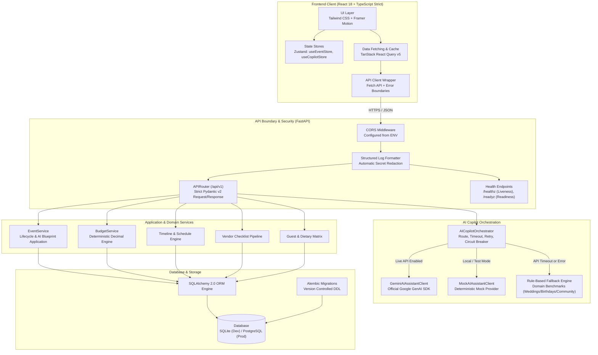
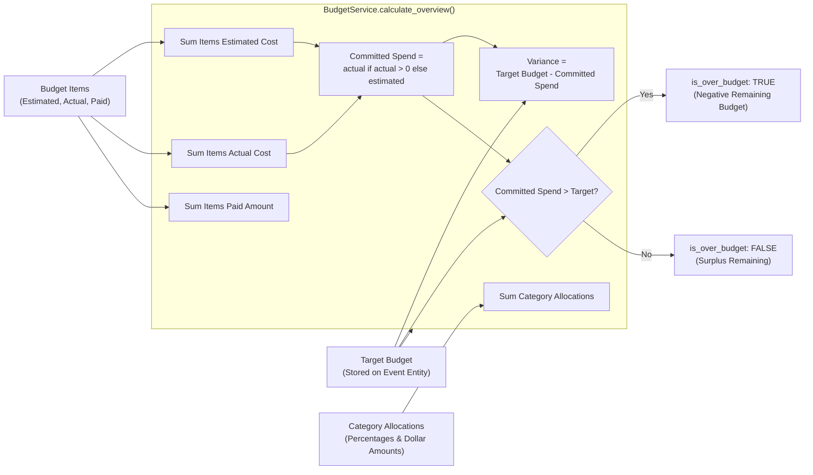

# System Architecture: AI Event Planner

## 1. Executive Summary

The **AI Event Planner** is an enterprise-grade, full-stack event orchestration platform engineered for **PromptWars Challenge 5**. The system enables users to conceptualize, schedule, budget, and execute three distinct event typologies:
1. **Weddings** (complex multi-phase timeline, high-touch vendor dependencies, delicate budget allocations)
2. **Birthdays** (activity and entertainment pacing, catering/cake coordination, theme customization)
3. **Community Events** (logistical permitting, volunteer roles, public safety, wide-reach scheduling)

The architecture is built upon four inviolable engineering pillars:
- **Clean Architecture & Separation of Concerns**: Strict boundary isolation across presentation, business logic, domain models, and persistence.
- **Deterministic Mathematical Integrity**: Financial calculations, variance tracking, and headcount statistics are calculated deterministically—never left to probabilistic LLM token predictions.
- **Autonomous AI Fault Tolerance**: Gemini 2.5 Flash operations are fronted by circuit breaking and bounded retries, immediately degrading to verified domain-heuristic fallbacks when offline or throttled.
- **Zero Secret Leakage**: Zero client-side API keys, strict environment isolation, automated log sanitization, and Pydantic input sanitization.

---

## 2. High-Level System Architecture

The following diagram illustrates the decoupled monorepo architecture, including the independent deployment lifecycle, client state stores, FastAPI dependency injection graph, and the dual-path AI orchestrator.



---

## 3. AI Orchestration & Autonomous Fallback Architecture

### 3.1 Design Principles & Retry Strategy
1. **Schema Enforcement**: All generative calls enforce structured output via `response_mime_type="application/json"` and Pydantic response models.
2. **Recoverable Error Classification & Bounded Retries with Jitter**:
   - **Non-Recoverable Errors**: Authentication failures (401/Invalid API Key), Permission Denied (403), Malformed Payloads (400), or Not Found (404) are **never retried**, failing fast and directly triggering the deterministic fallback.
   - **Recoverable Errors**: Rate Limits (429/ResourceExhausted), Gateway/Server Errors (500/502/503/504), and Network Timeouts are retried up to 3 times.
   - **Randomized Jitter**: Uses `wait_random_exponential(multiplier=1, min=1, max=4)` to distribute retries and eliminate thundering-herd spikes against provider rate limits.
3. **Hard Timeouts**: API calls enforce a strict 15-second timeout window.
4. **Circuit Breaker**: 5 consecutive failures flip the breaker from `CLOSED` to `OPEN`, immediately serving deterministic fallbacks for 60 seconds without exhausting network sockets or slowing down user interaction.
5. **No Hallucinated Vendor Pricing**: Prompts explicitly forbid generating fake vendor telephone numbers or fictitious pricing quotes.
6. **Localization & Currency**: Architected around Indian cultural event archetypes with default ISO 4217 currency `INR` and extensible `Intl.NumberFormat` support.

### 3.2 Sequence Diagram: AI Request Lifecycle

```mermaid
sequenceDiagram
    autonumber
    actor User as Event Planner (Browser)
    participant API as FastAPI Copilot Endpoint
    participant Orch as AICopilotOrchestrator
    participant CB as Circuit Breaker
    participant Gemini as Google GenAI SDK (Gemini 2.5)
    participant Fallback as Deterministic Fallback Engine
    participant DB as SQLite / PostgreSQL

    User->>API: POST /api/v1/copilot/generate-plan
    API->>Orch: generate_full_event_plan(request)
    
    alt Mock Mode Active (USE_MOCK_AI=true)
        Orch->>Orch: Invoke Mock Provider
        Orch-->>API: Return Mock Blueprint (source="mock")
    else Live Gemini Mode
        Orch->>CB: Check can_attempt()
        alt Circuit Breaker is OPEN
            Orch->>Fallback: generate_fallback_full_plan(request)
            Fallback-->>Orch: Return Rule-Based Plan (source="deterministic_fallback")
        else Circuit Breaker is CLOSED / HALF-OPEN
            Orch->>Gemini: generate_content(prompt, schema=AICopilotFullPlanResponse)
            alt Gemini Success (within 15s)
                Gemini-->>Orch: Valid Structured JSON
                Orch->>CB: record_success()
                Orch-->>API: Return Verified Plan (source="gemini")
            else Gemini Timeout / 5xx / Rate Limit
                Gemini-->>Orch: Error or Timeout
                Orch->>CB: record_failure()
                Orch->>Fallback: generate_fallback_full_plan(request)
                Fallback-->>Orch: Return Rule-Based Plan (source="deterministic_fallback")
            end
        end
    end

    API-->>User: 200 OK + StandardResponse[AICopilotFullPlanResponse]
    Note over User,API: User sees zero disruption; fallback notice indicates offline mode
```

---

## 4. Deterministic Budget Engine Architecture

To eliminate the critical risk of generative models hallucinating arithmetic additions or misallocating budgets, **all mathematical operations are executed in Python via `decimal.Decimal`**.



---

## 5. Core Architectural Modules

### 5.1 Event Management
- Central aggregate root managing event lifecycle states: `PLANNING` $\rightarrow$ `CONFIRMED` $\rightarrow$ `IN_PROGRESS` $\rightarrow$ `COMPLETED`.
- Multi-type polymorphism: specialized properties and validation for Weddings, Birthdays, and Community events.
- AI bootstrap pipeline: converts high-level intent into initialized database records.

### 5.2 AI Event Copilot
- Multi-turn conversational interface aware of the active event's budget, timeline, and guest counts.
- Structured suggestion actions that users can accept into their live plan with a single click.
- **Future Persistent Conversation Architecture (Target Phase 3)**:
  - `conversation_threads`: Tracks discrete topic threads per event with rolling summaries.
  - `conversation_messages`: Persists role (`user`, `assistant`, `system`), token counts, and actionable JSON suggestion payloads.
  - **Sliding-Window Token Control**: Retains rolling summary of historical dialogue + raw last 10 messages to bound context window and API token costs.

### 5.3 Budget Intelligence
- Categorized fund distribution (Venue, Catering, Photography, Entertainment, Decor, Contingency).
- Real-time variance tracking between quotes, actual invoices, and payments.
- Automatic 5% contingency buffer enforcement.

### 5.4 Timeline Management (`TimelineService`)
- **Two-tier scheduling**:
  1. **Macro-Milestones**: Phased checkpoints across 4 event lifecycle phases (`BEFORE_EVENT`, `WEEK_OF`, `DAY_OF`, `AFTER_EVENT`) with configurable priority levels (`LOW`, `MEDIUM`, `HIGH`, `CRITICAL`), target due dates, and completion status toggles.
  2. **Micro-Activities**: Minute-by-minute execution run-of-show scheduling with start/end time validation, location tagging, and completion tracking.
- **Deterministic Metrics Engine**:
  - `total_milestones`, `completed_milestones`, `completion_percentage` (calculated deterministically as `(completed / total) * 100`).
  - `overdue_milestones`: dynamically calculated by evaluating `target_date < now` and `is_completed is False`.
- **Pre-seeded Milestone Templates**: One-click seeding of domain-specific milestone sequences tailored to event typologies (`WEDDING`, `BIRTHDAY`, `COMMUNITY`, `OTHER`).
- **Data Integrity**: Enforces activity `start_time <= end_time` validation and cross-event isolation.

### 5.5 Vendor Management (`VendorService`)
- **Procurement Pipeline**: Tracks vendor lifecycles across five booking statuses: `RESEARCHING` $\rightarrow$ `CONTACTED` $\rightarrow$ `QUOTED` $\rightarrow$ `BOOKED` $\rightarrow$ `COMPLETED`.
- **Deterministic Financial Aggregations**:
  - `total_quoted`: sum of `estimated_quote` across all vendors.
  - `total_agreed`: sum of `contracted_amount` across all booked/completed vendors.
  - `advance_paid`: sum of advance deposits paid to vendors.
  - `remaining_payment`: derived deterministically as `total_agreed - advance_paid`.
  - Invariant enforcement: `advance_paid <= contracted_amount` strictly checked at Pydantic schema validation and service layer.
- **Pre-seeded Vendor Categories**: One-click category provisioning (Venue, Catering, Photography, Floral & Decor, Entertainment, Attire, Logistics, Officiant) with Lucide icon associations.
- **Safety Boundaries**: Strictly separates AI interview questions from real vendor contracts; eliminates fabricated pricing quotes or hallucinated contact information.

### 5.6 Inspiration Studio (`InspirationService`)
- **Aesthetic Moodboarding**:
  - Visual cards categorized across 9 domain categories (`Event Themes`, `Decorations`, `Color Palettes`, `Catering and Menus`, `Entertainment`, `Photography Concepts`, `Invitations`, `Activities`, `Other`).
  - Swatch presentation of color palettes with hex codes, theme tags, and notes.
  - Indicative budget estimates clearly demarcated as non-binding directional guidelines.
- **Gemini Creative Integration**:
  - Structured output schema validation (`response_schema=AIInspirationIdeasWrapper`) via official Google GenAI SDK.
  - Strict 15-second total operation deadline with bounded retries and exponential jitter.
  - Autonomous fallback failover to curated benchmark collections if offline or throttled.
  - "Review Before Saving" pattern: candidate ideas returned for user review without automatically overwriting existing moodboards.
  - Clear attribution: `source_type` tracks `USER` vs. `AI_GENERATED`.

### 5.7 Guest Management & Dietary Matrix (`GuestService`)
- **Headcount Forecasting & RSVP Pipeline**:
  - Full lifecycle tracking: `INVITED`, `CONFIRMED`, `DECLINED`, `MAYBE`, `WAITING`.
  - Invitation delivery tracking: `NOT_SENT`, `SENT`.
  - Editable guest categories: `Family`, `Friends`, `Colleagues`, `VIP`, `Community`, `Other`.
- **Deterministic Analytics Engine**:
  - `expected_attendance = confirmed_guests + confirmed_plus_ones`.
  - `attendance_rate = (confirmed_guests / total_guests) * 100`.
  - Dynamic catering dietary matrix counting specific preferences (Vegetarian, Vegan, Jain, Gluten-Free, Halal, Nut Allergies).
  - Accessibility requirements logging for step-free seating and mobility aids.
  - Strict cross-event tenant isolation enforced across all guest queries and mutations.

### 5.8 Dashboard and Analytics
- High-level executive dashboard aggregating budget burn-rate, milestone completion percentage, vendor hiring pipeline, and RSVP conversion rates.

### 5.9 AI Event Copilot & Safe Action Execution (`CopilotService`, `CopilotContextBuilder`)
- **Multi-Turn Persistent Conversations**:
  - Event-specific conversation threads persisted in `copilot_threads` and `copilot_messages` with cascade deletion.
  - Chronological message history with structured metadata (suggested follow-up prompts, contextual warnings, proposed actions).
- **Bounded Event Context Construction**:
  - `CopilotContextBuilder` synthesizes real-time snapshots of event metadata, budget burn rate, pending milestones, vendor bookings, and guest RSVP counts into a compact JSON payload bounded to 1,200–1,500 tokens.
  - Strict privacy and data minimization: aggregate metrics only, zero individual PII or medical/accessibility strings in prompt context.
- **Interactive Action Approval Workflow**:
  - Gemini operates purely as an advisor; direct database writes by AI are prohibited.
  - Action mutations (`ADD_TIMELINE_MILESTONE`, `ADD_DAY_OF_ACTIVITY`, `ADD_BUDGET_EXPENSE`, `ADD_VENDOR_ITEM`, `ADD_GUEST_PROFILE`, `SAVE_INSPIRATION_CARD`) are persisted as `PENDING` proposals.
  - Execution requires explicit user approval via `/copilot/actions/{id}/execute`, which re-validates schemas and delegates strictly through verified Python domain services.
  - Strict safeguards: duplicate execution prevention, dismissal guards, and cross-event isolation.

---

## 6. Security Architecture & Data Protection

| Dimension | Implementation Mechanism |
|---|---|
| **Secret Isolation** | Gemini API key is loaded strictly via backend environment settings; never exposed to frontend bundles. |
| **Log Scrubbing** | Custom `RedactingFormatter` scrubs Google API keys, JWTs, Authorization headers, and passwords. |
| **CORS Validation** | Explicit origin whitelisting configured via `ALLOWED_ORIGINS` environment variable. |
| **Container Hardening** | Backend runs as non-privileged `appuser` (UID 1000) inside minimal slim images. |
| **Input Validation** | Pydantic v2 enforces boundary limits (e.g., non-negative budgets, bounded guest numbers, sanitized text). |

---

## 7. Architectural Decision Records (ADRs) Summary

- **ADR-0001: Monorepo Structure**: Independent frontend and backend directories under a shared repository for cohesive type sharing, unified Docker Compose orchestration, and isolated CI/CD pipelines.
- **ADR-0002: Deterministic Budget Engine**: Enforces exact decimal arithmetic in the backend service layer for all financial aggregates, prohibiting LLM calculation hallucinations.
- **ADR-0003: AI Orchestration & Autonomous Fallbacks**: Wraps Google GenAI SDK inside circuit breaker and fallback heuristics to guarantee 100% platform availability.
- **ADR-0004: State Management & Data Fetching**: Pair Zustand for client UI/copilot state with TanStack React Query v5 for server cache invalidation and optimistic updates.

