# Database Design Specification: AI Event Planner

## 1. Entity-Relationship Overview

The AI Event Planner persistence layer is implemented in **SQLAlchemy 2.0** with **Alembic** migration management. The relational model utilizes 36-character string UUIDs for primary keys to ensure database engine portability across SQLite (local development) and PostgreSQL (production).

```mermaid
erDiagram
    EVENTS ||--o{ BUDGET_CATEGORIES : "has many"
    EVENTS ||--o{ BUDGET_ITEMS : "has many"
    BUDGET_CATEGORIES ||--o{ BUDGET_ITEMS : "groups"
    EVENTS ||--o{ TIMELINE_MILESTONES : "has many"
    TIMELINE_MILESTONES ||--o{ TIMELINE_ACTIVITIES : "groups"
    EVENTS ||--o{ TIMELINE_ACTIVITIES : "has many"
    EVENTS ||--o{ VENDOR_ITEMS : "has many"
    EVENTS ||--o{ GUESTS : "has many"
    EVENTS ||--o{ INSPIRATION_CARDS : "has many"
    VENDOR_CATEGORIES ||--o{ VENDOR_ITEMS : "classifies"

    EVENTS {
        string(36) id PK
        string(255) title "Event name"
        string(50) event_type "WEDDING, BIRTHDAY, COMMUNITY, OTHER"
        text description "nullable"
        string(255) location "nullable"
        datetime start_date "nullable"
        datetime end_date "nullable"
        integer expected_guest_count "default 0"
        numeric(12_2) target_budget "default 0.00"
        string(10) currency "default INR"
        string(50) status "PLANNING, CONFIRMED, IN_PROGRESS, COMPLETED, CANCELLED"
        datetime event_date "backward-compat nullable"
        string(255) theme "backward-compat nullable"
        text notes "backward-compat nullable"
        datetime created_at
        datetime updated_at
    }

    BUDGET_CATEGORIES {
        string(36) id PK
        string(36) event_id FK
        string(100) name
        numeric(12_2) allocated_amount "default 0.00"
        numeric(5_2) percentage_target "default 0.00"
        datetime created_at
        datetime updated_at
    }

    BUDGET_ITEMS {
        string(36) id PK
        string(36) category_id FK
        string(36) event_id FK
        string(255) title
        numeric(12_2) estimated_cost "default 0.00"
        numeric(12_2) actual_cost "default 0.00"
        numeric(12_2) paid_amount "default 0.00"
        string(50) status "ESTIMATED, PENDING, PAID"
        boolean is_ai_suggested "default false"
        text notes "nullable"
        datetime created_at
        datetime updated_at
    }

    TIMELINE_MILESTONES {
        string(36) id PK
        string(36) event_id FK
        string(255) title
        text description "nullable"
        string(50) phase "BEFORE_EVENT, WEEK_OF, DAY_OF, AFTER_EVENT"
        string(50) priority "default MEDIUM: LOW, MEDIUM, HIGH, CRITICAL"
        string(100) recommended_timeline "nullable"
        text key_tasks "nullable"
        integer order_index "default 0"
        datetime target_date "nullable"
        boolean is_completed "default false"
        datetime created_at
        datetime updated_at
    }

    TIMELINE_ACTIVITIES {
        string(36) id PK
        string(36) milestone_id FK "nullable"
        string(36) event_id FK
        string(255) title
        text description "nullable"
        datetime start_time "nullable"
        datetime end_time "nullable"
        string(255) location "nullable"
        boolean is_completed "default false"
        integer order_index "default 0"
        text notes "nullable"
        datetime created_at
        datetime updated_at
    }

    VENDOR_CATEGORIES {
        string(36) id PK
        string(100) name
        string(50) icon "nullable"
        datetime created_at
        datetime updated_at
    }

    VENDOR_ITEMS {
        string(36) id PK
        string(36) event_id FK
        string(36) category_id FK "nullable"
        string(255) vendor_name
        string(255) contact_name "nullable"
        string(100) contact_email "nullable"
        string(50) contact_phone "nullable"
        string(255) location "nullable"
        string(255) website "nullable"
        numeric(12_2) estimated_quote "default 0.00"
        numeric(12_2) contracted_amount "default 0.00"
        numeric(12_2) advance_paid "default 0.00"
        string(50) status "RESEARCHING, CONTACTED, QUOTED, BOOKED, COMPLETED"
        text contract_notes "nullable"
        datetime created_at
        datetime updated_at
    }

    GUESTS {
        string(36) id PK
        string(36) event_id FK
        string(255) name
        string(255) email "nullable"
        string(50) phone "nullable"
        string(50) category "default Friends: Family, Friends, Colleagues, VIP, Community, Other"
        string(50) rsvp_status "default INVITED: INVITED, CONFIRMED, DECLINED, MAYBE, WAITING"
        string(50) invitation_status "default NOT_SENT: NOT_SENT, SENT"
        integer plus_ones "default 0"
        string(255) dietary_preferences "nullable"
        string(255) dietary_restrictions "nullable"
        text accessibility_requirements "nullable"
        string(100) table_assignment "nullable"
        text notes "nullable"
        datetime created_at
        datetime updated_at
    }

    INSPIRATION_CARDS {
        string(36) id PK
        string(36) event_id FK
        string(255) title
        string(100) category "Themes, Decor, Palette, Catering, Entertainment, Photo, Invitations, Activities, Other"
        text description
        string(255) tags "nullable"
        text color_palette "nullable JSON array of hex codes"
        string(255) suggested_budget_range "nullable Indicative estimate"
        text notes "nullable"
        boolean is_ai_generated "default true"
        boolean is_saved "default true"
        string(50) source_type "default AI_GENERATED: USER, AI_GENERATED"
        datetime created_at
        datetime updated_at
    }

    COPILOT_THREADS {
        string(36) id PK
        string(36) event_id FK
        string(255) title "Session title"
        datetime created_at
        datetime updated_at
    }

    COPILOT_MESSAGES {
        string(36) id PK
        string(36) thread_id FK
        string(36) event_id FK
        string(50) role "user, assistant, system"
        text content
        text suggested_prompts "JSON array"
        text warnings "JSON array"
        string(50) source "gemini, mock, deterministic_fallback"
        datetime created_at
    }

    COPILOT_ACTIONS {
        string(36) id PK
        string(36) thread_id FK
        string(36) event_id FK
        string(50) action_type "ADD_TIMELINE_MILESTONE, ADD_DAY_OF_ACTIVITY, ADD_BUDGET_EXPENSE, ADD_VENDOR_ITEM, ADD_GUEST_PROFILE, SAVE_INSPIRATION_CARD"
        string(255) title
        text description
        text parameters "JSON payload"
        string(50) status "PENDING, EXECUTED, DISMISSED, FAILED"
        datetime executed_at "nullable"
        datetime created_at
    }
```

---

## 2. Migration Revisions

- **`001_initial_schema`**: Foundational schema creating all 9 domain entities, indexes, and foreign keys.
- **`002_add_event_fields`**: Phase 2 enhancement adding `description`, `start_date`, `end_date`, and `expected_guest_count` to the `events` table with batch alter support for SQLite & PostgreSQL portability.
- **`003_add_cascade_and_safeguards`**: Foreign key cascade cleanup on event deletion, category isolation, and budget deletion constraints.
- **`004_timeline_and_vendor_enhancements`**: Phase 3 enhancements adding `priority` and `description` to `timeline_milestones`, `order_index` and `description` to `timeline_activities`, and `location`, `website`, and `advance_paid` to `vendor_items`.
- **`005_guest_and_inspiration_enhancements`**: Phase 4 enhancements adding `category`, `invitation_status`, `accessibility_requirements`, and `dietary_preferences` to `guests`, plus `color_palette`, `suggested_budget_range`, `notes`, and `source_type` to `inspiration_cards`.
- **`006_copilot_conversation_persistence`**: Phase 5B persistence schema adding `copilot_threads`, `copilot_messages`, and `copilot_actions` tables with indexed foreign keys to `events.id`, cascade deletions, and state tracking for interactive AI action proposals.

---

## 3. Financial Integrity & Decimal Handling

All monetary fields (`target_budget`, `allocated_amount`, `estimated_cost`, `actual_cost`, `paid_amount`, `estimated_quote`, `contracted_amount`, `advance_paid`) are explicitly stored as `NUMERIC(12, 2)`:
- Strictly maps to Python `decimal.Decimal`
- Eliminates IEEE 754 floating-point rounding errors
- Default event currency is **INR** (Indian Rupee), fully extensible via standard ISO 4217 uppercase 3-letter codes
- Cross-event isolation is enforced at the database query and service layer
- Strict mathematical invariant: `advance_paid <= contracted_amount` validated at both Pydantic schema and service layers. Remaining payment is deterministically derived as `contracted_amount - advance_paid`.

---

## 4. Headcount Forecasting & Dietary Matrix Integrity

All guest statistics, conversion percentages, and catering dietary distribution counts are calculated deterministically:
- `expected_attendance = confirmed_guests + confirmed_plus_ones`
- `attendance_rate = (confirmed_guests / total_guests) * 100`
- Zero probabilistic LLM hallucinations in headcount or dietary reporting
- Absolute cross-event isolation verified on all queries and mutations
