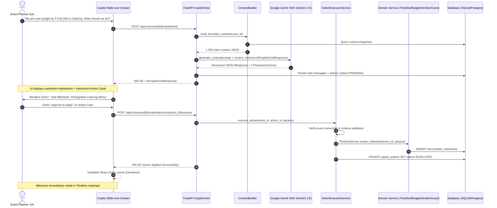
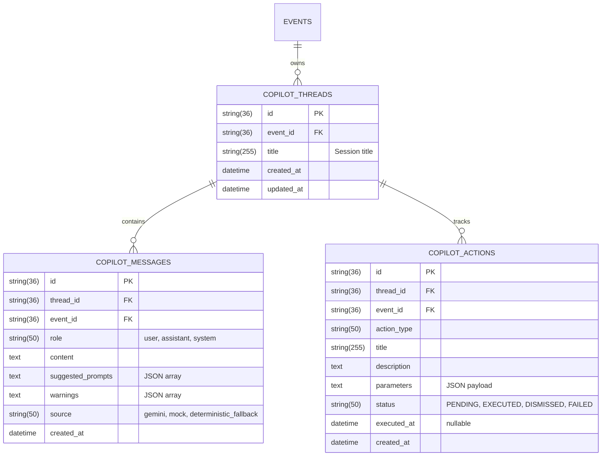

# Phase 5 Implementation Plan: AI Event Copilot & Interactive Planning

**Project:** PromptWars Challenge 5 - AI Event Planner  
**Document:** Phase 5A Architectural Specification & Implementation Roadmap  
**Author:** Senior Full-Stack Architect & AI Systems Engineer  
**Status:** **PROPOSED - PENDING USER APPROVAL FOR PHASE 5B**

---

## 1. Executive Summary & Architectural Vision

The **AI Event Copilot** elevates the platform from a collection of discrete management modules (Budget, Timeline, Vendors, Guests, Inspiration) into an **autonomous, proactive event planning assistant**. It bridges creative ideation and deterministic execution without compromising financial accuracy, data integrity, or tenant isolation.

### Core Architectural Principles
1. **GenAI-First, Zero ML Overhead**: Powered purely by Gemini 2.5 Flash via the official Google GenAI SDK (`google-genai`). No local weights, model training, or PyTorch/TensorFlow dependencies.
2. **Zero Direct AI Database Writes**: Gemini acts strictly as an **advisor and proposal generator**. It cannot mutate database state directly.
3. **Structured Action Approval Workflow**: All AI suggestions that affect event state (e.g., adding milestones, creating expense ledger items, seeding vendor checklists) are emitted as structured Pydantic payloads. These require explicit user confirmation ("Review & Apply") before backend execution.
4. **Bounded Event-Aware Context**: The Copilot synthesizes bounded, real-time event snapshots (budget burn, timeline milestones, vendor pipeline, guest RSVPs, inspiration cards) without blind table dumps or prompt bloat.
5. **Deterministic Resilience**: Inherits the established 15-second hard operation deadline, bounded retries with randomized jitter, circuit breaking (5 consecutive errors $\rightarrow$ 60s open circuit), and rule-based fallback heuristics.
6. **Secret Isolation & INR Standard**: Zero client-side API keys; all financial parameters use fixed-point `Decimal` with default ISO 4217 currency `INR`.

---

## 2. Inspection of Existing Components & Reuse Matrix

| Existing Module | Component / File | Reusability in Phase 5 |
| :--- | :--- | :--- |
| **AI Provider Abstraction** | `backend/app/services/ai/interface.py` | Reuse `AIAssistantInterface`. Extend `chat_copilot` method signature to accept structured action proposals. |
| **Gemini Client** | `backend/app/services/ai/gemini_client.py` | Reuse `GeminiAIAssistantClient._execute_generate_content` with response schema enforcement (`AICopilotChatResponse`). |
| **Mock Provider** | `backend/app/services/ai/mock_client.py` | Extend `chat_copilot` in `MockAIAssistantClient` to emit deterministic test actions for vitest and pytest suites. |
| **Circuit Breaker** | `backend/app/services/ai/circuit_breaker.py` | Reuse existing `CircuitBreaker` (5 failures, 60s reset window) for chat calls. |
| **Rule Fallback** | `backend/app/services/ai/fallback.py` | Enhance `generate_fallback_chat_reply` to evaluate event context (e.g. over-budget, unbooked vendors) and offer deterministic action proposals. |
| **AI Orchestrator** | `backend/app/services/ai/orchestrator.py` | Reuse `AICopilotOrchestrator` dependency injection; add conversation thread resolution and context injection. |
| **Budget Service** | `backend/app/services/budget_service.py` | Reuse `calculate_overview` for bounded budget context; reuse `create_item` to execute approved budget actions. |
| **Timeline Service** | `backend/app/services/timeline_service.py` | Reuse `get_timeline_overview` for milestone context; reuse `create_milestone` and `create_activity` for action execution. |
| **Vendor Service** | `backend/app/services/vendor_service.py` | Reuse `get_vendor_summary` for procurement context; reuse `create_vendor` for action execution. |
| **Guest Service** | `backend/app/services/guest_service.py` | Reuse `get_guest_analytics` for RSVP & catering dietary context; reuse `create_guest` for action execution. |
| **Inspiration Service** | `backend/app/services/inspiration_service.py` | Reuse `list_inspiration_cards` for moodboard context; reuse `create_inspiration_card` for action execution. |
| **Frontend State** | `frontend/src/stores/useCopilotStore.ts` | Expand Zustand store to support thread IDs, suggested prompts, action card states, and fallback indicators. |
| **Frontend Navigation** | `frontend/src/components/layout/Navbar.tsx` | Connect existing "AI Copilot" button to trigger the slide-over Copilot Drawer. |

---

## 3. Detailed Architecture Design

### 3.1 Bounded Event Context Construction (`CopilotContextBuilder`)
To avoid prompt bloat, high token costs, and attention degradation, the backend will introduce a dedicated `CopilotContextBuilder` service that extracts a targeted snapshot bounded to approximately **1,200 – 1,500 tokens**:

```text
+-----------------------------------------------------------------------------------+
|                        Bounded Copilot Context Payload                            |
+-----------------------------------------------------------------------------------+
| 1. EVENT METADATA: Title, Type (WEDDING), Location, Dates, Guest Count, Target ₹  |
| 2. BUDGET SNAPSHOT: Target, Committed Spend, Actual, Remaining ₹, Over-Budget?   |
|    - Top 5 Category Allocations (Allocated vs. Spent)                             |
| 3. TIMELINE SNAPSHOT: Total Milestones, Overdue Count, Completion %               |
|    - Next 3 Pending Milestones (Title, Due Date, Priority)                        |
|    - Next 2 Day-Of Activities                                                     |
| 4. VENDOR SNAPSHOT: Total Vendors, Booked Count, Advance Paid, Remaining Balance  |
|    - Count by Status: RESEARCHING (x), QUOTED (y), BOOKED (z)                     |
| 5. GUEST & CATERING SNAPSHOT: Total Invited, Confirmed Heads (with +1s), Maybe    |
|    - Top Dietary Allocations (e.g. Vegetarian: 45, Jain: 12, Vegan: 8)            |
| 6. INSPIRATION MOODBOARD: Saved Card Count, Top 3 Aesthetic Concept Titles        |
| 7. CONVERSATION ROLLING WINDOW: Last 6 messages (3 user turns + 3 assistant turns)|
+-----------------------------------------------------------------------------------+
```

### 3.2 Proposed Pydantic Response Schemas (`backend/app/schemas/copilot.py`)

```python
from enum import Enum
from typing import List, Optional, Dict, Any
from pydantic import BaseModel, Field

class CopilotActionType(str, Enum):
    ADD_TIMELINE_MILESTONE = "ADD_TIMELINE_MILESTONE"
    ADD_DAY_OF_ACTIVITY = "ADD_DAY_OF_ACTIVITY"
    ADD_BUDGET_EXPENSE = "ADD_BUDGET_EXPENSE"
    ADD_VENDOR_ITEM = "ADD_VENDOR_ITEM"
    ADD_GUEST_PROFILE = "ADD_GUEST_PROFILE"
    SAVE_INSPIRATION_CARD = "SAVE_INSPIRATION_CARD"

class CopilotActionStatus(str, Enum):
    PENDING = "PENDING"
    EXECUTED = "EXECUTED"
    DISMISSED = "DISMISSED"
    FAILED = "FAILED"

class CopilotWarning(BaseModel):
    warning_type: str = Field(description="BUDGET_OVERRUN, TIMELINE_OVERDUE, DIETARY_ALERT, VENDOR_UNCOMMITTED")
    severity: str = Field(default="MEDIUM", description="LOW, MEDIUM, HIGH, CRITICAL")
    message: str

class CopilotProposedAction(BaseModel):
    action_id: str = Field(description="Client-side correlation UUID")
    action_type: CopilotActionType
    title: str = Field(description="Concise human-readable action title")
    description: str = Field(description="Reasoning and impact of this action")
    parameters: Dict[str, Any] = Field(description="Exact creation parameters conforming to domain schema")
    status: CopilotActionStatus = Field(default=CopilotActionStatus.PENDING)

class AICopilotChatResponse(BaseModel):
    response: str = Field(description="Conversational markdown guidance")
    suggested_prompts: List[str] = Field(default=[], description="Interactive follow-up chips")
    proposed_actions: List[CopilotProposedAction] = Field(default=[], description="Structured actionable mutations")
    warnings: List[CopilotWarning] = Field(default=[], description="Contextual alerts")
    source: str = Field(default="gemini", description="gemini, mock, deterministic_fallback")
```

---

## 4. Interactive Action Approval Workflow



---

## 5. Database Schema for Conversation Persistence (Alembic 006)

To support persistent, event-specific multi-turn dialogue, we propose two normalized tables:



### Tenant Isolation & Security
- Every thread, message, and action has an indexed foreign key to `events.id` with `ondelete="CASCADE"`.
- All endpoints verify that the `thread_id` and `action_id` strictly belong to the route's `event_id`.
- Action execution re-runs strict Pydantic validation before touching domain tables.

---

## 6. Proposed API Contracts

### 6.1 Copilot Conversation Endpoints
- `GET /api/v1/events/{event_id}/copilot/threads`: List conversation threads for the event.
- `POST /api/v1/events/{event_id}/copilot/threads`: Create a fresh conversation thread.
- `GET /api/v1/events/{event_id}/copilot/threads/{thread_id}/messages`: Retrieve message history (ordered chronologically).
- `POST /api/v1/events/{event_id}/copilot/threads/{thread_id}/messages`: Send user message, invoke orchestrator with bounded context, persist response, and return `AICopilotChatResponse`.
- `DELETE /api/v1/events/{event_id}/copilot/threads/{thread_id}`: Clear or delete conversation thread.

### 6.2 Interactive Action Execution Endpoints
- `POST /api/v1/events/{event_id}/copilot/actions/{action_id}/execute`: User approves action. Backend validates schema, executes via verified domain service, marks action `EXECUTED`, and returns created resource details.
- `POST /api/v1/events/{event_id}/copilot/actions/{action_id}/dismiss`: User rejects action. Marks action `DISMISSED`.

---

## 7. Frontend User Interface Design (`CopilotDrawer`)

### 7.1 Component Tree (`frontend/src/features/copilot/`)
- `CopilotDrawer.tsx`: Slide-over drawer container with smooth open/close transitions, responsive backdrop, and header with active event context pill.
- `CopilotMessageList.tsx`: Scrollable message stream auto-scrolling to newest response.
- `CopilotMessageBubble.tsx`: Renders Markdown content, source attribution pill (`Gemini 2.5` vs `Offline Fallback`), warnings, and action cards.
- `CopilotActionCard.tsx`: Interactive card rendering action type, summary, parameters, and "Approve & Apply" / "Dismiss" buttons.
- `CopilotInputBar.tsx`: Text input with character limits, send button, loading spinner, and suggested prompt pills.

### 7.2 UI State Management (`useCopilotStore.ts`)
```typescript
interface CopilotState {
  isOpen: boolean;
  activeThreadId: string | null;
  isLoading: boolean;
  isExecutingAction: Record<string, boolean>; // actionId -> boolean
  toggleDrawer: () => void;
  openDrawer: () => void;
  closeDrawer: () => void;
}
```

---

## 8. Comprehensive Testing & Regression Strategy

### 8.1 Backend Tests (`backend/app/tests/test_copilot_phase5.py`)
1. **Context Construction Test**: Verify `CopilotContextBuilder` includes valid event, budget, timeline, vendor, and guest data while adhering to token bounds.
2. **Mock Provider Multi-Turn Dialogue**: Verify chat response includes markdown, suggested prompts, and structured proposed actions.
3. **Structured Action Schema Validation**: Verify invalid parameters or unsupported action types are rejected with HTTP 422.
4. **Action Approval Execution**:
   - Approve `ADD_TIMELINE_MILESTONE` $\rightarrow$ verifies record appears in `timeline_milestones`.
   - Approve `ADD_VENDOR_ITEM` $\rightarrow$ verifies record appears in `vendor_items`.
   - Approve `ADD_BUDGET_EXPENSE` $\rightarrow$ verifies record appears in `budget_items` and updates Decimal committed spend.
5. **Cross-Event Security**: Verify actions belonging to Event A cannot be executed on Event B.
6. **AI Reliability & Offline Fallback**:
   - Missing API key triggers deterministic fallback.
   - Circuit breaker trips to open after 5 consecutive failures and serves fallback actions.
   - 15-second operation deadline strictly maintained.

### 8.2 Frontend Tests (`frontend/src/test/CopilotChat.test.tsx`)
1. **Drawer Toggle & Message Stream**: Verify opening drawer via Navbar button and rendering chat bubbles.
2. **Suggested Prompts Click**: Verify clicking a suggestion sends message to API.
3. **Action Card Approval**: Verify clicking "Approve & Apply" calls action execution endpoint and invalidates query cache.
4. **Offline Fallback Alert**: Verify alert banner displays when `source === 'deterministic_fallback'`.

### 8.3 Regression Verification
- Run complete backend pytest suite (all 64 existing tests must remain 100% passing).
- Run complete frontend vitest suite (all 29 existing tests must remain 100% passing).
- Strict TypeScript compile (`tsc --noEmit`) with 0 errors.
- Vite production build.

---

## 9. Identified Risks and Architectural Decisions for User Approval

1. **Database Writes Exclusively Through Service Layer**:
   *Decision:* The Copilot service will never issue raw SQL or direct model inserts for proposed actions. It will delegate directly to `TimelineService`, `BudgetService`, `VendorService`, `GuestService`, and `InspirationService`. This guarantees all business rules, cascade checks, and invariant constraints (e.g. `advance_paid <= contracted_amount`) are uniformly preserved.
2. **Action Confirmation Expiration**:
   *Decision:* Proposed actions will remain in `PENDING` state until explicitly executed or dismissed. If an underlying entity (e.g. category) is deleted prior to approval, execution will safely fail with HTTP 404/422 without corrupting state.
3. **Context Length vs Token Efficiency**:
   *Decision:* Bound conversation history to rolling last 6 messages. Historical context is preserved via rolling summaries.

---

## 10. Next Steps (Pending User Approval)

Upon approval of this architecture specification, implementation will proceed in **Phase 5B**:
1. Author and execute Alembic migration `006_copilot_conversation_persistence.py`.
2. Implement `CopilotContextBuilder` and `CopilotActionExecutor`.
3. Update `GeminiAIAssistantClient`, `MockAIAssistantClient`, and `fallback.py` with structured proposed actions.
4. Update Copilot FastAPI routers with thread and action execution endpoints.
5. Build frontend `CopilotDrawer`, `CopilotMessageBubble`, and `CopilotActionCard`.
6. Run full test suites, capture E2E verification screenshots, and deliver Phase 5 report.

