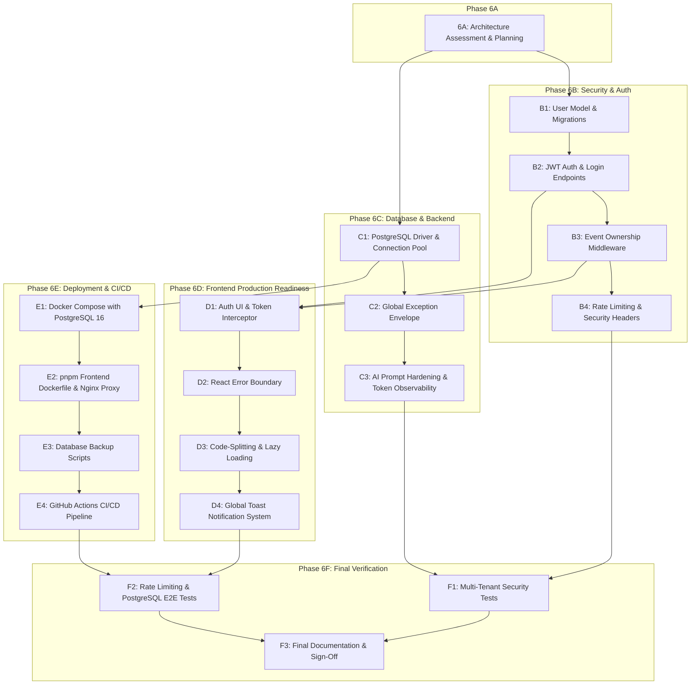

# Phase 6A: Production Readiness Assessment & Implementation Planning Report

**Project:** PromptWars Challenge 5 - AI Event Planner  
**Phase:** 6A (Production Readiness Assessment & Implementation Planning)  
**Date:** November 1, 2026  
**Status:** **INSPECTION & PLANNING COMPLETE** (Pending Review & Approval)

---

## 1. Current Architecture Assessment

The AI Event Planner is a modern, full-stack event management and planning platform specialized for weddings, birthdays, community gatherings, and corporate celebrations. The existing architecture is partitioned into four major layers:

```text
+-------------------------------------------------------------------------+
|                      Frontend Client (Vite / React 18)                  |
|  - TypeScript (Strict Mode)   - Tailwind CSS & Framer Motion            |
|  - Zustand Stores (Event, Copilot) - TanStack React Query v5            |
|  - Slide-Over Copilot Drawer  - Domain Views (Budget, Timeline, etc.)   |
+------------------------------------+------------------------------------+
                                     |  REST HTTP / JSON (/api/v1)
+------------------------------------v------------------------------------+
|                      Backend API (FastAPI / Uvicorn)                    |
|  - Pydantic v2 Validation     - Standard Envelope Responses             |
|  - Dependency Injection       - Redacting Sensitive Logging Formatter   |
|  - Service Layer Architecture - Zero Autonomous Writes Copilot Policy   |
+------------------+---------------------------------+--------------------+
                   |                                 |
+------------------v---------------+ +---------------v--------------------+
|  Persistence Layer               | |  AI Copilot Layer                  |
|  - SQLAlchemy 2.0 ORM            | |  - Official Google GenAI SDK       |
|  - Alembic Migrations (001-006)  | |  - Gemini 2.5 Flash (`response_schema`)|
|  - SQLite (WAL Mode / Dev)       | |  - Circuit Breaker (In-Memory)     |
|  - Atomic Action Claim (PENDING) | |  - Deterministic Fallback Engine   |
+----------------------------------+ +------------------------------------+
```

### Architectural Strengths
1. **Separation of Concerns**: Strict boundary between API routers, Pydantic schemas, domain services (`EventService`, `BudgetService`, `TimelineService`, `VendorService`, `GuestService`, `InspirationService`, `CopilotService`), and SQLAlchemy persistence models.
2. **Deterministic Business Core**: All financial math (allocations, actual spend, variance, over-budget detection) is executed exclusively in Python using exact `Decimal` arithmetic—zero reliance on GenAI for calculations.
3. **Controlled Action Execution**: Gemini and mock providers propose structured actions with status `PENDING`. Database mutations strictly require explicit user approval.
4. **Resilient Autonomous Fallback**: If Gemini times out (>15s) or fails, the orchestrator trips its circuit breaker and activates rule-based deterministic planning algorithms without throwing unhandled 500 errors.
5. **High Test Coverage**: 133 total automated tests (86 backend Pytest + 47 frontend Vitest) and a comprehensive 27-scenario Playwright E2E suite.

---

## 2. Production-Ready Capabilities (Existing Strengths)

The following capabilities have already been implemented, rigorously tested, and meet production-grade standards:

| Capability | Implementation Detail | Verification Status |
|---|---|---|
| **Deterministic Financial Math** | Uses `Decimal(12, 2)` throughout SQLAlchemy, Pydantic, and domain services. Zero floating-point drift. Overrun alerts and percentage calculations are mathematically verified. | Verified (13 Pytest tests) |
| **Credential Redaction in Logs** | Custom `RedactingFormatter` in `backend/app/core/logging.py` scrubs Google API keys (`AIza...`), Bearer tokens, and password patterns before stream output. | Verified |
| **Guest Privacy in AI Prompts** | `CopilotContextBuilder` aggregates guest analytics (total count, confirmed RSVP count, dietary category percentages) and strips all personal identifiers (names, emails, phone numbers, notes) before sending context to Gemini. | Verified |
| **Action Execution Concurrency** | `CopilotService.execute_action` atomically claims pending actions (`PENDING` $\rightarrow$ `EXECUTING`), preventing concurrent double-execution and returning `HTTP 409 Conflict`. | Verified (E2E & Pytest) |
| **Failure Recovery** | If domain execution fails, the action status reverts cleanly to `PENDING` with full database transaction rollback. | Verified |
| **Cross-Domain Cache Invalidation** | Frontend TanStack React Query invalidates `events`, `budget`, `timeline`, and `vendors` query keys upon action execution, ensuring immediate visual synchronization. | Verified |
| **Liveness & Readiness Probes** | `/api/v1/healthz` and `/api/v1/readyz` probe application health, database connectivity, and AI provider mode. | Verified |
| **TypeScript & Build Integrity** | Strict TypeScript compilation passes with zero errors; production Vite build produces optimized, gzipped assets. | Verified |

---

## 3. Comprehensive Gap & Risk Assessment

Findings across all six operational areas are categorized by severity: **CRITICAL**, **HIGH**, **MEDIUM**, and **LOW**.

### 3.1 Security and Application Protection

| Finding ID | Severity | Area | Description & Risk |
|---|---|---|---|
| **SEC-01** | **CRITICAL** | AuthN / AuthZ | **No Authentication Mechanism**: The API has no user authentication (JWT, sessions, OAuth2, or API keys). All endpoints (`/api/v1/events/...`) are publicly reachable without identity verification. |
| **SEC-02** | **CRITICAL** | Authorization / Multi-Tenancy | **No Event Ownership / Tenant Isolation**: The `events` table has no `user_id` or `owner_id`. Any client can read, update, or delete any event, access guest contact info, and execute Copilot actions on any event in the database. |
| **SEC-03** | **CRITICAL** | Abuse Prevention | **No API Rate Limiting**: Costly endpoints like `POST /events/{event_id}/copilot/threads/{thread_id}/messages` and `POST /events/with-ai-plan` trigger Gemini API calls and have zero rate limiting. Vulnerable to DoS, quota exhaustion, and billing spikes. |
| **SEC-04** | **HIGH** | Data Privacy | **Guest PII Exposed via Unauthenticated REST**: While AI prompts sanitize PII, `GET /api/v1/events/{event_id}/guests` returns full guest records (names, emails, phone numbers, dietary restrictions, accommodation notes) unauthenticated to anyone knowing the UUID. |
| **SEC-05** | **MEDIUM** | Input Validation | **Unvalidated Email and Phone Fields**: `GuestBase` and `VendorItemBase` treat `email` and `phone` as unvalidated strings rather than using `EmailStr` and E.164 phone regex patterns. |
| **SEC-06** | **MEDIUM** | HTTP Hardening | **Missing Security Headers**: The API lacks standard security headers (`X-Content-Type-Options: nosniff`, `X-Frame-Options: DENY`, `Strict-Transport-Security`, `Content-Security-Policy`). |
| **SEC-07** | **LOW** | Information Disclosure | **Unrestricted Swagger in Production**: `/docs` and `/redoc` are enabled by default regardless of the `ENVIRONMENT` setting, exposing internal API schemas. |

### 3.2 Database and Backend Reliability

| Finding ID | Severity | Area | Description & Risk |
|---|---|---|---|
| **DB-01** | **CRITICAL** | Database Driver | **PostgreSQL Driver Missing (`psycopg`)**: `pyproject.toml` lists `sqlalchemy` and `alembic` but omits `psycopg` or `psycopg2-binary`. Running with `DATABASE_URL=postgresql://...` will immediately crash on startup with `ModuleNotFoundError`. |
| **DB-02** | **HIGH** | Connection Pooling | **Unconfigured Production Connection Pool**: `backend/app/core/database.py` only configures SQLite `check_same_thread`. It lacks PostgreSQL connection pool settings (`pool_size`, `max_overflow`, `pool_recycle`, `pool_timeout`), risking connection exhaustion under load. |
| **DB-03** | **HIGH** | SQLite Foreign Keys | **Missing SQLite Foreign Key Listener**: SQLite does not enforce foreign key cascades unless `PRAGMA foreign_keys=ON` is emitted on connection. Local dev SQLite currently does not enforce database-level relational constraints. |
| **DB-04** | **MEDIUM** | Error Handling | **No Global Unhandled Exception Handler**: Unhandled internal exceptions return default Starlette 500 plain text or HTML instead of the standardized `StandardResponse` JSON envelope. |
| **DB-05** | **LOW** | Request Tracing | **Request Logging Middleware Disabled**: `RequestLoggingMiddleware` is commented out in `main.py`, losing per-request latency and status code telemetry. |

### 3.3 AI Infrastructure

| Finding ID | Severity | Area | Description & Risk |
|---|---|---|---|
| **AI-01** | **HIGH** | Scalability | **In-Memory Circuit Breaker State**: `CircuitBreaker` stores state in Python memory. In a multi-worker (Uvicorn workers > 1) or multi-container deployment, breaker state is isolated per process, causing inconsistent failovers. |
| **AI-02** | **HIGH** | Cost & Quota Control | **No Token Tracking or Cost Accounting**: Prompt and completion token counts are not measured or recorded. Runaway AI interactions could cause billing spikes without audit visibility. |
| **AI-03** | **MEDIUM** | Security | **Direct Prompt Interpolation**: User messages are formatted directly into the prompt string without using Gemini's native `system_instruction` parameter to isolate system rules from user input. |
| **AI-04** | **LOW** | Observability | **No Prometheus / Telemetry Metrics**: Latencies and fallback rates are logged as text but not exported as time-series metrics. |

### 3.4 Frontend Production Readiness

| Finding ID | Severity | Area | Description & Risk |
|---|---|---|---|
| **FE-01** | **HIGH** | Resilience | **Missing Global React Error Boundary**: An uncaught rendering error in any component unmounts the entire React tree, leaving the user with a blank white screen. |
| **FE-02** | **MEDIUM** | Performance | **No Code Splitting / Lazy Loading**: All feature tabs (`DashboardView`, `EventsView`, `BudgetView`, `TimelineView`, `VendorView`, `GuestView`, `InspirationView`, `CopilotDrawer`) are bundled into a single JavaScript file (`439 kB`). |
| **FE-03** | **MEDIUM** | UX / Feedback | **No Global Toast Notification System**: Action execution, error feedback, and mutation confirmations rely on localized banners rather than a unified toast feed. |
| **FE-04** | **LOW** | Accessibility | **Focus Trap & ARIA Keyboard Audit**: While `Escape` key closes the Copilot drawer, focus is not strictly trapped inside the modal/drawer when open. |

### 3.5 Deployment and Infrastructure

| Finding ID | Severity | Area | Description & Risk |
|---|---|---|---|
| **OPS-01** | **CRITICAL** | Containerization | **No PostgreSQL Container in `docker-compose.yml`**: Docker Compose only specifies backend and frontend services with SQLite volume mounting. There is no PostgreSQL container, health check, or volume setup. |
| **OPS-02** | **HIGH** | Build Discrepancy | **Frontend Dockerfile Uses `npm` Instead of `pnpm`**: The Dockerfile runs `npm install` despite the project using `pnpm` and `pnpm-lock.yaml`, risking build divergence. |
| **OPS-03** | **HIGH** | Configuration | **Build-Time `VITE_API_BASE_URL` vs Runtime Proxy**: `VITE_API_BASE_URL` is baked into static assets at build time. In production Docker setups, requests should route through the Nginx reverse proxy (`/api/v1`) relative to the domain. |
| **OPS-04** | **MEDIUM** | Disaster Recovery | **No Database Backup & Recovery Scripts**: No automated backup routines (`pg_dump` or SQLite snapshot scripts) exist for persistent storage protection. |
| **OPS-05** | **MEDIUM** | Automation | **No CI/CD Pipeline Configuration**: No GitHub Actions workflows exist to validate tests, typechecking, and Docker builds on pull requests. |

### 3.6 Testing and Quality

| Finding ID | Severity | Area | Description & Risk |
|---|---|---|---|
| **TST-01** | **HIGH** | Security Testing | **Missing Auth & Multi-Tenancy Tests**: No automated tests exist to verify that User A cannot access or mutate User B's events, budget items, or Copilot threads. |
| **TST-02** | **MEDIUM** | Migration Testing | **No Migration Reversibility Tests**: No test verifies that Alembic migrations can cleanly execute `downgrade -1`. |
| **TST-03** | **LOW** | Dialect Testing | **No CI Dialect Test for PostgreSQL**: All tests currently run against in-memory SQLite (`sqlite:///:memory:`). PostgreSQL-specific behavior is not verified in automated testing. |

---

## 4. Prioritized Implementation Roadmap (Phase 6)

To resolve all identified gaps systematically and safely without regressions, Phase 6 is organized into five focused, sequential sub-phases:

```text
Phase 6A: Production Assessment & Planning (CURRENT - COMPLETE)
   │
   ▼
Phase 6B: Security, Authentication & Multi-Tenancy Architecture
   │
   ▼
Phase 6C: Production Database & Backend Hardening
   │
   ▼
Phase 6D: Frontend Production Readiness & UX Hardening
   │
   ▼
Phase 6E: Production Infrastructure, Containerization & CI/CD
   │
   ▼
Phase 6F: Final Multi-Tenant E2E Verification & Handover
```

---

### Detailed Sub-Phase Specifications

#### Phase 6B: Security, Authentication & Multi-Tenancy Architecture
- **Focus**: User authentication, event-level ownership, rate limiting, and input sanitization.
- **Tasks**:
  1. Add `User` model (`id`, `email`, `hashed_password`, `full_name`, `is_active`, `created_at`).
  2. Implement password hashing using `bcrypt` and JWT token generation (`access_token` with expiration).
  3. Create auth endpoints (`POST /api/v1/auth/register`, `POST /api/v1/auth/login`, `GET /api/v1/auth/me`).
  4. Add `owner_id` foreign key to `events` table with an Alembic migration (`007_add_users_and_event_ownership.py`).
  5. Implement `get_current_active_user` dependency in `app/api/deps.py` and enforce event ownership checks on all `/events/{event_id}/*` endpoints.
  6. Add rate-limiting middleware (`slowapi` or custom in-memory token bucket) restricting AI endpoints to 10 requests/minute per user/IP.
  7. Harden Pydantic schemas using `EmailStr` and E.164 phone regex validation.
  8. Add HTTP security headers middleware and environment-gated `/docs`.

#### Phase 6C: Production Database & Backend Hardening
- **Focus**: PostgreSQL compatibility, connection pooling, global exception handling, and AI observability.
- **Tasks**:
  1. Add `psycopg[binary]>=3.2.0` to `backend/pyproject.toml`.
  2. Update `backend/app/core/database.py` with PostgreSQL connection pooling (`pool_size=10`, `max_overflow=20`, `pool_recycle=1800`) and SQLite foreign key listener.
  3. Add global unhandled exception handler in `backend/app/main.py` formatting uncaught errors into `StandardResponse`.
  4. Refactor `CircuitBreaker` in `orchestrator.py` to support distributed state or configurable threshold persistence.
  5. Refactor Gemini chat prompt to use native `system_instruction` parameter to prevent prompt injection.
  6. Add token usage logging and AI latency tracking.

#### Phase 6D: Frontend Production Readiness & UX Hardening
- **Focus**: Error boundaries, code splitting, global toast notifications, and auth UI.
- **Tasks**:
  1. Implement a top-level and feature-level React `ErrorBoundary` component with fallback UI.
  2. Introduce `React.lazy()` and `Suspense` for dashboard, budget, timeline, vendors, guests, inspiration, and copilot modules.
  3. Add a lightweight toast notification system (e.g. `sonner` or custom Zustand toast store) for mutation feedback.
  4. Add Authentication UI (Login / Register view, JWT storage in secure local storage or cookie, auth state in Zustand).
  5. Configure Axios / Fetch API client to automatically attach `Authorization: Bearer <token>` to all requests.

#### Phase 6E: Production Infrastructure, Containerization & CI/CD
- **Focus**: PostgreSQL container in Docker Compose, pnpm multi-stage Docker build, backup scripts, and CI/CD.
- **Tasks**:
  1. Update `docker-compose.yml` to include a `postgres:16-alpine` service with volume persistence and health check.
  2. Update frontend `Dockerfile` to use `pnpm` multi-stage build and configure Nginx reverse proxying for `/api/v1`.
  3. Create automated backup and restore shell scripts (`scripts/backup_db.sh`, `scripts/restore_db.sh`).
  4. Create GitHub Actions CI workflow (`.github/workflows/ci.yml`) running backend pytest, frontend vitest, TypeScript typecheck, and Docker build.
  5. Author `PRODUCTION_DEPLOYMENT_GUIDE.md` covering environment setup, migration execution, and backup routines.

#### Phase 6F: Final Multi-Tenant E2E Verification & Handover
- **Focus**: Comprehensive multi-tenant security verification, Playwright E2E testing with auth, and sign-off.
- **Tasks**:
  1. Author backend integration tests verifying strict cross-tenant data isolation (User A cannot access User B's events, budget, or copilot chat).
  2. Verify rate-limiting behavior (assert `HTTP 429 Too Many Requests`).
  3. Run full Playwright E2E suite with authentication flows, capturing updated production screenshots.
  4. Verify production build and Docker Compose spin-up with PostgreSQL.
  5. Author final `PHASE_6_COMPLETION_REPORT.md`.

---

## 5. Task Dependencies & Precedence



---

## 6. Acceptance Criteria by Sub-Phase

### Phase 6B: Security, Authentication & Multi-Tenancy
- [ ] User registration, login, and `/auth/me` endpoints return valid JWT tokens with `HTTP 200/201`.
- [ ] Passwords stored using industry-standard salted hashes (`bcrypt`).
- [ ] `events.owner_id` foreign key is enforced; events can only be accessed or modified by their owner.
- [ ] Unauthenticated requests to protected `/events` endpoints return `HTTP 401 Unauthorized`.
- [ ] Unauthorized requests to other users' events return `HTTP 403 Forbidden` or `HTTP 404 Not Found`.
- [ ] AI endpoints return `HTTP 429 Too Many Requests` when rate limits are exceeded.
- [ ] Security headers (`X-Content-Type-Options`, `X-Frame-Options`, `Content-Security-Policy`) present in all HTTP responses.

### Phase 6C: Production Database & Backend Hardening
- [ ] `psycopg` is installed and verified against PostgreSQL connection string.
- [ ] SQLite foreign key cascades are enforced in development via SQLite connection listener.
- [ ] Unhandled exceptions return `HTTP 500` inside `StandardResponse` JSON envelope.
- [ ] Gemini API prompts use `system_instruction` to isolate prompt instructions from user input.
- [ ] AI request duration and token counts are logged with every LLM interaction.

### Phase 6D: Frontend Production Readiness
- [ ] Top-level and feature-level `ErrorBoundary` catches rendering errors and displays a user-friendly recovery UI without full-page crash.
- [ ] Feature tabs load asynchronously via `React.lazy()` and `Suspense`, reducing main bundle size.
- [ ] Global toast notifications appear on successful action execution and API errors.
- [ ] Users can register, log in, log out, and retain authenticated sessions across page reloads.

### Phase 6E: Infrastructure, Containerization & CI/CD
- [ ] `docker compose up --build` launches PostgreSQL 16, FastAPI backend, and Nginx frontend cleanly.
- [ ] Frontend Docker build utilizes `pnpm` and builds cleanly without lockfile errors.
- [ ] Database backup and restore shell scripts execute successfully and verify table row counts.
- [ ] GitHub Actions workflow passes automated lint, typecheck, pytest, vitest, and docker build steps.

### Phase 6F: Final Verification & Handover
- [ ] All unit and integration test suites pass (100% pass rate).
- [ ] Automated security tests confirm zero cross-tenant data leakage.
- [ ] Automated Playwright E2E suite passes all authenticated workflows.
- [ ] Production runbook and deployment documentation complete.

---

## 7. Conclusion & Next Steps

Phase 6A assessment and planning is complete. No code changes or dependencies have been modified in accordance with the Phase 6A rules.

The codebase is well-structured and possesses strong deterministic foundations, but requires authentication, multi-tenancy enforcement, rate limiting, and PostgreSQL containerization before production deployment.

**Phase 6B implementation will begin upon your explicit review and approval of this plan.**

